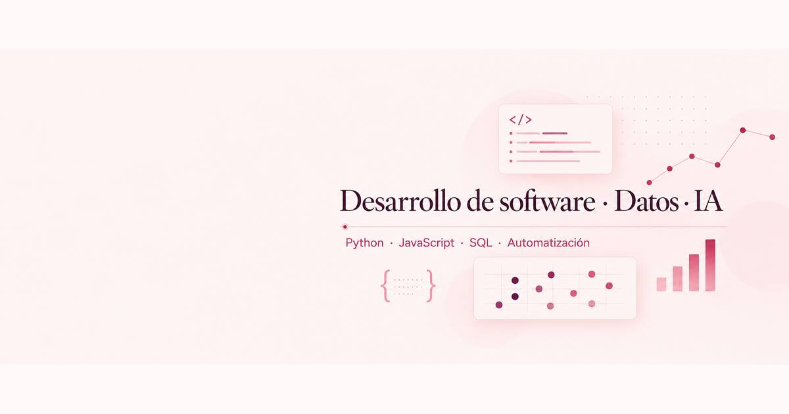

# Natalia Chescotta · Portfolio

Portfolio profesional de **Natalia Chescotta**, desarrolladora Full Stack Junior y estudiante de Ciencia de Datos e Inteligencia Artificial en el IFTS N.º 12.

**[Ver portfolio publicado](https://laschescottas-cyber.github.io/portfolio-nati/)**



## Objetivo

Mostrar proyectos reales de desarrollo web, automatización y productos digitales, explicando las tecnologías usadas, qué problema resuelven y el alcance de mi participación.

## Contenido

- **Selección destacada:** entrada rápida a TuPlannersNC, Abriguemos a un Niño y Chuli Facturador.
- **Productos propios:** TuPlannersNC, herramientas digitales para estudio y una agenda generada en Python.
- **Identidad visual:** presentación destacada del Manual de Identidad Visual de Abriguemos a un Niño (trabajo académico grupal).
- **Desarrollo y clientes:** aplicaciones, automatizaciones y sitios web para negocios.
- **Sobre mí:** formación técnica y experiencia en procesos administrativos y financieros.
- **Habilidades y contacto:** stack de herramientas, LinkedIn, GitHub y CV imprimible.
- **Casos técnicos:** desafíos, soluciones y arquitectura de proyectos seleccionados.

## Proyectos destacados

| Proyecto | Tecnologías | Enlace |
| --- | --- | --- |
| Chuli Facturador | Python, FastAPI, SQLite, Pandas | [Demo pública](https://laschescottas-cyber.github.io/chuli-facturador-demo/demo/) |
| Mi Cuaderno Digital | React, Next.js, TypeScript, Supabase | [Producto](https://www.tuplannersnc.com.ar/#cuaderno-digital) |
| Mi Progreso Académico | JavaScript, Supabase, PWA | Acceso privado |
| Agenda Interactiva 2027 | Python, Jinja2, WeasyPrint | [Caso técnico](https://laschescottas-cyber.github.io/portfolio-nati/casos-tecnicos.html#agenda) |
| JN Soluciones Integrales | HTML, CSS, JavaScript | [Sitio](https://laschescottas-cyber.github.io/jn-soluciones-integrales/) |
| T&A Tech | HTML, CSS, JavaScript | [Sitio](https://laschescottas-cyber.github.io/ta-tech/) |

[**Leer los casos de estudio técnicos**](https://laschescottas-cyber.github.io/portfolio-nati/casos-tecnicos.html).

## Stack del sitio

Portfolio estático en **HTML5, CSS3 y JavaScript**, publicado con **GitHub Pages**, sin dependencias de compilación.

```text
portfolio-nati/
├── index.html
├── casos-tecnicos.html
├── abriguemos-identidad-visual.html
├── cv.html
├── styles.css
├── assets/
│   ├── favicon.svg
│   └── projects/
└── README.md
```

## Probar localmente

```bash
git clone https://github.com/laschescottas-cyber/portfolio-nati.git
cd portfolio-nati
python -m http.server 8000
```

Abrir `http://localhost:8000/`.

## Accesibilidad, rendimiento y SEO

- Navegación con teclado, salto al contenido y foco visible.
- Menú completo en celulares y vistas responsive.
- Imágenes en WebP cuando es posible y carga diferida.
- Preferencia por movimiento reducido, metadatos Open Graph, URL canónica y favicon.

## Privacidad

Los proyectos privados, las credenciales y los datos de usuarios no se comparten. El caso de **Abriguemos a un Niño** es un trabajo académico grupal no oficial.

## Contacto

[LinkedIn](https://www.linkedin.com/in/natalia-chescotta) · [GitHub](https://github.com/laschescottas-cyber) · [Portfolio](https://laschescottas-cyber.github.io/portfolio-nati/)
